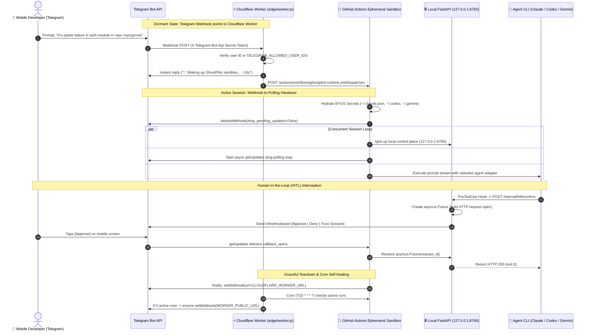

# 👻 GhostPilot (PocketAgent)

> **Control autonomous coding agents (Claude Code, OpenAI Codex CLI, and Gemini CLI) straight from your mobile phone via Telegram, executing in free ephemeral cloud sandboxes (GitHub Actions) using your flat monthly AI subscriptions (Claude Pro/Max, ChatGPT Plus/Pro, Gemini).**  
> **\$0/month server cost. No home PC left on. No 24/7 VPS. Full mobile Human-in-the-Loop approvals.**

---

[](https://github.com/dariobou/PocketAgent/actions/workflows/ci-tests.yml)
[](https://opensource.org/licenses/MIT)
[](https://python.org)
[](https://docs.anthropic.com/en/docs/agents-and-tools/claude-code)
[](https://openai.com)
[](https://gemini.google.com)

---

## ⚡ The Problem GhostPilot Solves

Today's state-of-the-art autonomous coding agents (**Claude Code**, **OpenAI Codex CLI**, and **Google Gemini CLI**) are strictly terminal-bound tools designed to run on a local developer workstation.

If you are away from your desk, commuting, out for a walk, or at the gym:
1. **You cannot run them** unless you keep a physical desktop PC turned on 24/7 at home with sleep inhibitors.
2. **You waste money** paying \$15–\$50/month for a persistent Linux cloud VPS that sits idle 95% of the time.
3. **You get hit with massive API bills** if you call raw LLM API keys instead of utilizing the flat \$20/month subscriptions (Claude Pro/Max, ChatGPT Plus/Pro) you already pay for.
4. **Interactive terminal prompts break headless runners**: Claude Code and terminal tools pause expecting terminal keystrokes when asking to run `rm`, edits, or bash commands.

**GhostPilot solves this completely.**

---

## 🏛️ Architecture: Hybrid Edge-to-Runner Handover + Local FastAPI Control Plane



---

## 📱 Mobile-First Experience: How It Works on Your Phone

> [!TIP]
> **Zero installations on your phone.** No Termux, no local Python, no SSH client, no port forwarding.  
> You control everything through standard chat and tap-to-approve buttons in the official **Telegram** app.

### 1. Instant Doorbell & Streaming Updates
Whenever you send a prompt from your phone, GhostPilot responds in **1 second** from the edge. As soon as the runner boots, incoming reasoning tokens and tool calls stream live into your chat:

```text
📱 Telegram Chat:

[You]: Clone repo dariobou/web-app and fix the broken authentication endpoint

[GhostPilot]: 🚀 Waking up GhostPilot ephemeral sandbox on GitHub Actions... (takes ~15s)

[GhostPilot]: ⚡ GhostPilot Online
• Agent: claude
• Repo: dariobou/web-app (Branch: main)

🤖 GhostPilot (claude):
I am analyzing `src/auth.py`. 
Found missing Bearer token validation on line 42. Writing fix...
```

### 2. Interactive Human-in-the-Loop (HITL) Approvals
When an agent attempts a mutating or potentially destructive operation (`rm`, `git push`, file edits, network downloads), it doesn't freeze or fail. Instead, GhostPilot's FastAPI control plane holds the agent process and sends interactive buttons directly to your screen:

```text
🟡 Approval Required (Risk: HIGH)

• Tool: Bash
• Action: Execute mutating bash: rm -rf dist/ && npm run build
• Request ID: 4f8a12bc

Do you approve this operation?
[ ✅ Approve ]    [ ❌ Deny ]
     [ 🛡️ Trust Session ]
```

- **Tap `[ ✅ Approve ]`**: Subprocess resumes immediately (`exit 0`).
- **Tap `[ ❌ Deny ]`**: Rejection reason is fed back to the agent via `stderr` (`exit 2`), prompting it to propose a safer alternative.
- **Tap `[ 🛡️ Trust Session ]`**: Auto-approves all subsequent mutating commands for the remainder of this session.

### 3. One-Click Pull Request Creation
Finished testing code? Type `/pr Added OAuth validation` on your phone:
- GhostPilot automatically creates a new branch `ghostpilot/<timestamp>`.
- Commits all changed files.
- Pushes to GitHub and opens a Pull Request via GitHub REST API.
- Returns the clickable PR link directly to your Telegram chat.

### 4. Zero-Cost Auto-Teardown
- **Auto-shutdown on idle**: If you stop chatting for 5 minutes (default: 300s), the runner restores the Cloudflare webhook and terminates itself.
- **Manual stop**: Send `/stop` at any time to kill the runner immediately.
- **Session safety budget**: Hard cap of 25 minutes per session prevents runaway runner usage.

---

## 🚀 5-Minute Setup Guide

You only need to run this setup **once**. After setup, you never need to open your computer again.

### Step 1: Create your Telegram Bot (1 minute)
1. Open Telegram on your phone or desktop and search for **[@BotFather](https://t.me/BotFather)**.
2. Send `/newbot`, choose a display name (e.g., `My GhostPilot`) and a username ending in `bot` (e.g., `my_ghostpilot_bot`).
3. Copy the **HTTP API Token** provided by BotFather (e.g., `7123456789:ABCdefGhIJKlmNoPQRstuv-WXYZ12345678`).
4. Search for **[@userinfobot](https://t.me/userinfobot)** and send `/start` to get your numeric user **Id** (e.g., `123456789`). This guarantees only your Telegram account can control your agents.

### Step 2: Fork / Clone & Run Setup Wizard (2 minutes)
Clone your repository and install dependencies:
```bash
git clone https://github.com/dariobou/PocketAgent.git
cd PocketAgent
pip install -e .
```

Run the interactive terminal wizard:
```bash
ghostpilot-setup
```
The wizard will:
- Verify your GitHub CLI (`gh`) login.
- Ask for your **Telegram Bot Token** and **Telegram User ID**.
- Automatically detect your local subscription credentials (`~/.codex/auth.json`, `~/.gemini/oauth_creds.json`, or prompt for your `CLAUDE_CODE_OAUTH_TOKEN` from `claude setup-token`).
- Sync all secrets directly to your GitHub repository secrets via `gh secret set`.

*(Alternatively, you can manually enter these secrets in your GitHub repository under `Settings > Secrets and variables > Actions`)*.

### Step 3: Deploy the Cloudflare Worker Edge Gateway (1 minute)
The Cloudflare Worker is the stateless doorbell that sleeps at \$0 cost until you send a message:

```bash
cd edge
# Edit edge/wrangler.toml with your GH_OWNER, GH_REPO, and TELEGRAM_ALLOWED_USER_IDS
npx wrangler secret put TELEGRAM_BOT_TOKEN
npx wrangler secret put TELEGRAM_WEBHOOK_SECRET
npx wrangler secret put GH_DISPATCH_TOKEN  # GitHub PAT with 'repo' and 'workflow' scope

npx wrangler deploy
```

### Step 4: Link Webhook to Telegram
Point your Telegram bot to your newly deployed Cloudflare Worker:
```bash
curl -X POST "https://api.telegram.org/bot<YOUR_BOT_TOKEN>/setWebhook" \
     -H "Content-Type: application/json" \
     -d '{"url": "https://<YOUR_WORKER_URL>", "secret_token": "<YOUR_WEBHOOK_SECRET>"}'
```

🎉 **You are done!** Put your phone in your pocket, head out to the gym, and start controlling autonomous coding agents wherever you are.

---

## 📱 Mobile Commands Catalog

| Command | Action |
| :--- | :--- |
| `/start`, `/help` | Displays current active agent, target repo, active branch, and session status. |
| `/repo <owner/repo> [branch]` | Clones or switches target workspace repo on the fly using `GITHUB_PAT`. |
| `/agent <claude\|codex\|gemini>` | Dynamically hot-swaps the active coding agent adapter. |
| `/diff` | Returns `git diff --stat` and `git diff` formatted as code (or attached file if > 3800 chars). |
| `/pr [title]` | Commits changes on branch `ghostpilot/<timestamp>`, pushes to remote, and opens a GitHub Pull Request. |
| `/status` | Shows sandbox health, session trusted state, and pending approvals. |
| `/stop` | Cancels agent (`SIGTERM` → `SIGKILL`), restores Cloudflare Webhook, and tears down the runner. |

---

## 🔐 Security & BYOS (Bring Your Own Subscription)

- **Strict Sandbox Isolation**: All code executes inside GitHub's isolated, ephemeral virtual machines with no access to your home network or personal computer.
- **Zero-API-Key Execution**: By hydrating Base64 OAuth tokens (`CODEX_AUTH_JSON_B64`, `GEMINI_OAUTH_B64`, `CLAUDE_CODE_OAUTH_TOKEN`), GhostPilot consumes your existing unlimited/flat-rate subscriptions with standard permissions (`0o600`).
- **Automated Headless Onboarding**: Automatically pre-populates `~/.claude.json` with `{"hasCompletedOnboarding": true, "bypassPermissionsModeAccepted": false}` so Claude Code never hangs in non-interactive CI environments.
- **Log Scrubber Filter (`SecretMaskingFilter`)**: Intercepts all output written to GitHub Actions runner logs, scrubbing Anthropic keys (`sk-ant-*`), OpenAI keys (`sk-*`), GitHub PATs (`ghp_*`, `github_pat_*`), and bot tokens before they hit public consoles.
- **Single-User Access Control**: Incoming Telegram messages and webhook callbacks verify user IDs strictly against `TELEGRAM_ALLOWED_USER_IDS`. Unauthorized attempts are silently dropped and logged.

---

## 📊 Comparison Against VPS-Dependent Tools

| Feature | Persistent VPS (e.g. EC2/Droplet) | Home PC + Tailscale Tunnel | GhostPilot (PocketAgent) |
| :--- | :--- | :--- | :--- |
| **Monthly Server Cost** | \$10 – \$40/month | \$0 (electricity + hardware wear) | **\$0.00 / month** |
| **Setup Complexity** | High (SSH, systemd, reverse proxies, SSL) | High (keep PC awake, sleep inhibitors) | **2 minutes (`ghostpilot-setup`)** |
| **Subscription Reuse (BYOS)**| Often requires raw pay-per-token API keys | Manual | **Native (Claude Pro, ChatGPT+, Gemini)** |
| **Inbound Ports / NAT** | Inbound public IP required | Complex mesh/VPN tunneling | **None (Webhook-to-Polling Handover)** |
| **Mobile HITL Approvals** | Plain text terminal | None | **Interactive Telegram Inline Keyboards** |
| **Automated PR Creation** | Manual terminal commands | Manual terminal commands | **Native mobile command (`/pr`)** |
| **Cold Idle Power** | Always running | Always drawing power | **Stateless sleeping edge gateway** |

---

## 🧪 Testing & Code Quality

GhostPilot includes a comprehensive pytest suite testing Base64 BYOS secret decoding, `0o600` permission enforcement, log secret scrubbers, agent stream parsers, debounced message chunking, and FastAPI HITL resolution:

```bash
# Run test suite
pytest -vv

# Run Ruff linter
ruff check .
```

---

## 📄 License

MIT License. See [LICENSE](LICENSE) for details.
