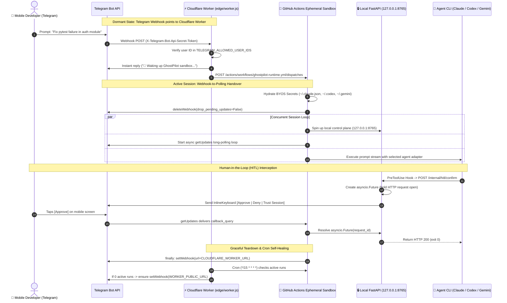

# 👻 GhostPilot (PocketAgent)

> **Autonomous AI Coding Agents from your mobile phone via Telegram, executing in free ephemeral cloud sandboxes (GitHub Actions) using your flat monthly subscriptions (Claude Pro/Max, ChatGPT Plus/Pro, Gemini).**
> **\$0/month server cost. No home PC turned on. No 24/7 VPS.**

---

[](https://github.com/your-username/PocketAgent/actions/workflows/ci-tests.yml)
[](https://opensource.org/licenses/MIT)
[](https://python.org)

---

## ⚡ The Problem GhostPilot Solves

Today's state-of-the-art coding agents (**Claude Code**, **OpenAI Codex CLI**, and **Google Gemini CLI**) are strictly terminal-bound tools designed to run on a local developer workstation.

If you are away from your desk, commuting, or only have your smartphone:
1. **You cannot run them** unless you keep your desktop workstation running 24/7.
2. **You waste money** paying \$15–\$50/month for a persistent Linux cloud VPS.
3. **You get hit with massive API bills** if you call raw LLM API keys instead of utilizing the flat \$20/month subscriptions (Claude Pro/Max, ChatGPT Plus/Pro) you already pay for.
4. **Interactive approvals break headless runners**: Claude Code and terminal tools pause expecting terminal keystrokes when asking to run `rm`, edits, or bash commands.

**GhostPilot solves this completely.**

---

## 🏛️ Architecture: Hybrid Edge-to-Runner Handover + Local FastAPI Control Plane



---

## 🚀 2-Minute Quickstart

### 1. Fork / Clone the Repository
```bash
git clone https://github.com/your-username/PocketAgent.git
cd PocketAgent
pip install -e .
```

### 2. Run the Interactive Setup Wizard
GhostPilot comes with an automated wizard that extracts local subscription files (`~/.codex/auth.json`, `~/.gemini/oauth_creds.json`, `CLAUDE_CODE_OAUTH_TOKEN`) and syncs them to your GitHub repository secrets via the GitHub CLI:
```bash
ghostpilot-setup
```

### 3. Deploy the Edge Doorbell (Cloudflare Worker)
```bash
cd edge
wrangler deploy
```

That's it! Send any prompt or command to your Telegram bot:
```
Fix the failing tests in repo yourname/my-project
```
Within ~15 seconds, GitHub Actions spins up an ephemeral runner, deletes the webhook, streams token progress into Telegram, and requests tap-to-approve confirmation before any destructive bash operations.

---

## 📱 Mobile Commands Catalog

| Command | Action |
| :--- | :--- |
| `/start`, `/help` | Displays current active agent, target repo, branch, and status. |
| `/repo <owner/repo> [branch]` | Clones or switches target workspace repo using `GITHUB_PAT`. |
| `/agent <claude\|codex\|gemini>` | Dynamically switches active coding agent adapter on the fly. |
| `/diff` | Generates `git diff` output (sent as text or file attachment if > 3800 chars). |
| `/pr [title]` | Commits changes on branch `ghostpilot/<timestamp>`, pushes to remote, and opens a GitHub Pull Request. |
| `/status` | Shows sandbox health, session trusted state, and pending approvals. |
| `/stop` | Cancels agent (`SIGTERM` → `SIGKILL`), restores Cloudflare Webhook, and terminates runner. |

---

## 🛡️ Human-in-the-Loop (HITL) Interception

GhostPilot injects a `PreToolUse` hook into `.claude/settings.json` matching `"Bash|Write|Edit|MultiEdit"`. 

- **Safe Read-Only Operations** (`ls`, `pwd`, `cat`, `git status`, `pytest`, `ruff`) are auto-approved instantly when `AUTO_APPROVE_READONLY=true`.
- **Mutating Operations** (`rm`, `mv`, `git push`, file edits, network downloads) hold the agent subprocess open and send an interactive inline keyboard to your phone:
  - **`[Approve]`** -> Resumes execution (`exit 0`).
  - **`[Deny]`** -> Injects rejection reason to `sys.stderr` and returns `exit 2` so Claude Code re-evaluates.
  - **`[Trust Session]`** -> Auto-approves all subsequent mutating commands for the remainder of this session.

---

## 📊 Comparison Against VPS-Dependent Tools

| Feature | Persistent VPS (e.g. EC2/Droplet) | Home PC / Tailscale Tunnel | GhostPilot (PocketAgent) |
| :--- | :--- | :--- | :--- |
| **Monthly Server Cost** | \$10 – \$40/month | \$0 (electricity cost) | **\$0.00 / month** |
| **Setup Complexity** | High (SSH, systemd, reverse proxies) | High (keep PC on, sleep inhibitors) | **2 minutes (`ghostpilot-setup`)** |
| **Subscription Reuse (BYOS)**| Often requires raw API tokens | Manual | **Native (Claude Pro, ChatGPT+, Gemini)** |
| **Inbound Ports / NAT** | Inbound IP required | Complex VPN/mesh | **None (Webhook-to-Polling Handover)** |
| **Mobile HITL Approvals** | Plain text / Terminal | None | **Interactive Telegram Inline Keyboards** |
| **Automated PR Creation** | Manual git commands | Manual git commands | **Native mobile command (`/pr`)** |

---

## 🧪 Testing & Verification

GhostPilot includes a comprehensive pytest suite testing Base64 BYOS secret decoding, `0o600` permission enforcement, log secret scrubbers, agent stream parsers, debounced message chunking, and FastAPI HITL resolution:

```bash
pytest -v
ruff check .
```

---

## 📄 License

MIT License. See [LICENSE](LICENSE) for details.
